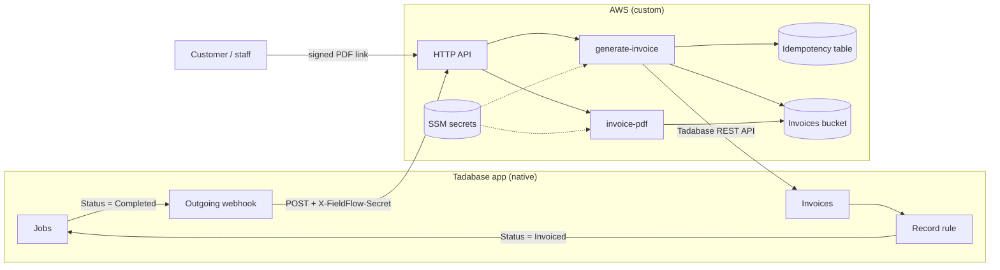

# FieldFlow

A field-service job tracker: customers, technicians, jobs, line items and invoices. It is built
natively on the low-code platform [Tadabase](https://tadabase.io), and extended with a small amount
of code where the platform falls short:

- **AWS Lambda functions** (`functions/`, Node 24, deployed with AWS SAM) for server-side work the
  platform can't do, such as rendering PDF invoices.
- **Widgets** (`widgets/`, vanilla JS/CSS, from plan 05) injected into app pages for interactions
  the native components lack, such as a signature pad or a drag-and-drop board.

**The rule: build natively first; write code only when the platform can't do it.** The data, the
forms, the totals and the status rules all live in Tadabase. Every custom piece is listed, with the
reason it exists, in [Native vs custom](#native-vs-custom).

## Contents
- [How it works](#how-it-works)
- [Native vs custom](#native-vs-custom)
- [Features](#features)
- [Repository layout](#repository-layout)
- [Getting started](#getting-started)
- [Setting up the Tadabase app and AWS](#setting-up-the-tadabase-app-and-aws)
- [Deploying](#deploying)
- [Development](#development)
- [Safety rules](#safety-rules)
- [Project status and roadmap](#project-status-and-roadmap)

## How it works



1. A technician finishes a job, and someone sets its **Status** to `Completed` in the app.
2. A Tadabase **outgoing webhook** sends `POST /webhooks/job-completed` with the job id and a
   shared secret header.
3. **`generate-invoice`** checks the secret, re-reads the job, its customer and its line items
   through the Tadabase API, renders a PDF, stores it in a private S3 bucket, and creates an
   **Invoices** record with the amount and a signed link to the PDF. It does this exactly once per
   job, however many times the webhook is delivered.
4. A native **record rule** on Invoices moves the job to `Invoiced`.
5. Anyone holding the link opens the PDF through **`invoice-pdf`**, which checks the signature and
   streams the file. The bucket itself is never public.

## Native vs custom

| Need | Built with | Why |
|---|---|---|
| Tables: customers, technicians, jobs, job items, invoices | **Native** | Tadabase is the database and the UI |
| Forms, job details pages, technician pages | **Native** | Standard Tadabase pages and components |
| Line totals and the job total | **Native** | Equation and rollup fields |
| Status changes (for example, `Invoiced` when an invoice is connected) | **Native** | Record rules |
| Triggering work when a job is completed | **Native** | Outgoing webhooks, filtered by status |
| PDF invoice, generated and stored privately | **Custom**, Lambda (plan 04) | No server-side PDF rendering, and no private file storage reachable through the API |
| Signature capture, and a total that updates while typing | **Custom**, widgets (plan 05) | Native forms have no drawing pad, and totals update only on save |
| Drag-and-drop kanban board by status | **Custom**, widget and proxy Lambda (plan 06) | No native kanban view with drag-to-update |
| Syncing contacts to a CRM, validating jobs | **Custom**, Lambdas (plan 07) | Needs custom logic and calls to another API |

## Features

### Invoice generation (`functions/generate-invoice`)
- **Trigger:** `POST /webhooks/job-completed`, body `{"recordId": "<job id>"}`, header
  `X-FieldFlow-Secret`. It doesn't trust the payload: it re-reads the job and does nothing unless
  the job's status is `Completed`.
- **Invoice number:** `INV-<jobId>`, deterministic, so a retry always produces the same number and
  the same file.
- **Strict money handling:** prices are parsed strictly in US format (`1234.50`, at most 2
  decimals), quantities allow up to 3 decimals, and all math is in integer cents. If the native
  Total disagrees with the line items, no invoice is made, and the function says why.
- **Exactly once:** a DynamoDB idempotency claim (`invoice#<jobId>`, 60 s lease, owner token) guards
  the side effects. The function also checks the app for an invoice already connected to the job, or
  one with the same number, as a safety net.
- **PDF:** rendered with [pdf-lib](https://pdf-lib.js.org) using the standard fonts. It has a
  business header, customer block, job details, a line-item table that continues across pages, and
  the total. Business details come from `config/invoice.json`.
- **Responses:**

  | Status | Meaning |
  |---|---|
  | `201` | Invoice created |
  | `200` | Invoice already exists, or the job isn't Completed (nothing done) |
  | `401` | Missing or wrong webhook secret |
  | `409` | Another delivery for the same job is still running; retry later |
  | `422` | The job can't be invoiced: no customer, no line items, an unreadable amount, or a Total that doesn't match. Fix the job and save it again. |
  | `502` / `503` | The app didn't answer, or time ran out. Nothing is lost: a retry finishes it without making a second invoice. |

### Invoice links (`functions/invoice-pdf`)
- `GET /invoices/<jobId>.pdf?sig=<signature>`. The signature is an HMAC-SHA256 of a versioned
  message (`invoice:v1:<jobId>`), keyed with the `link-secret` SSM parameter, and checked in
  constant time.
- The link never expires, and it opens only that one PDF. Rotating `link-secret` invalidates every
  existing link.
- The PDF comes back directly (`private, no-store`, `nosniff`). A bad signature gives `403`, and a
  missing PDF gives `404`.

### Health check (`functions/health`)
- `GET /health` returns `{ ok, stage }`. It has no secret, no data and no platform calls, and is
  used to smoke-test a deploy.

## Repository layout

```
functions/            One folder per Lambda, each with a handler.js
  health/             GET /health
  generate-invoice/   POST /webhooks/job-completed
  invoice-pdf/        GET /invoices/{jobId}.pdf
lib/                  Shared code, bundled into each function by esbuild
  http.js             wrap() for every handler, json(), parseJsonBody()
  errors.js           HTTP and platform errors, and how they map to responses
  webhook.js          Constant-time check of the X-FieldFlow-Secret header
  validate.js         Small input validators
  schema.js           Logical names (jobs.status) ↔ Tadabase slugs (field_NN)
  secrets.js          SSM SecureString loader, with caching
  runtime.js          Per-container setup: config, schema, secrets, adapter, logger
  idempotency.js      Exactly-once claims (DynamoDB, or in memory for tests)
  invoice.js          Invoice building and strict money parsing (integer cents)
  pdf.js              PDF rendering (pdf-lib)
  links.js            Signed, versioned invoice links
  aws.js              Lazy S3 and DynamoDB clients from the Lambda runtime SDK
  log.js              JSON logger that redacts secrets
  platform/           The data adapter: interface, in-memory version, Tadabase REST version
widgets/              Front-end widgets (from plan 05)
config/
  tadabase.dev.json   Table ids and field slugs for the dev app
  tadabase.prod.json  Same for the prod app
  invoice.json        Business details printed on invoices
scripts/
  tadabase-check.js   Read-only check of the Tadabase app against the mapping
  scan-secrets.sh     Secret scanner (pre-commit and CI)
tests/                Vitest: functions, lib, adapters (contract tests), infra and hooks
docs/
  tadabase-setup.md   Step-by-step app and AWS setup
  plans/              One design document per task, with its status
template.yaml         AWS SAM template: API, functions, roles, bucket, table, log groups
samconfig.toml        Deploy settings for dev and prod
.claude/              Claude Code hooks, agents and skills that guard this repo
```

## Getting started

### Prerequisites
- **Node.js 24** (`.nvmrc`; run `nvm use`)
- **npm** (comes with Node)
- For building and deploying: the **[AWS SAM CLI](https://docs.aws.amazon.com/serverless-application-model/latest/developerguide/install-sam-cli.html)** and the **AWS CLI**, with credentials for your account
- A **Tadabase** account on the **Pro plan or higher** (outgoing webhooks need it)

### Install and run the checks
```bash
git clone https://github.com/dtrinidad-iv/fieldflow.git
cd fieldflow
nvm use
npm install         # also installs the git pre-commit hook (.githooks/)
npm test            # runs entirely offline, against an in-memory adapter
```

You don't need a Tadabase app or an AWS account to develop and test. The tests never touch the
network.

## Setting up the Tadabase app and AWS

The full step-by-step guide is **[docs/tadabase-setup.md](docs/tadabase-setup.md)**. In short:

1. **Create two Tadabase apps**, `FieldFlow` (prod) and `FieldFlow Dev`. Build prod first, then
   duplicate it. Each AWS stage only ever talks to its own app.
2. **Build the five tables** (Customers, Technicians, Jobs, Job Items, Invoices) with the fields
   and types listed in the guide, plus the native totals and record rules.
3. **Create two API keys per app:** `fieldflow-aws` (read and write, stored only in AWS) and
   `fieldflow-check` (read-only, for your laptop).
4. **Store the secrets in SSM Parameter Store** as SecureStrings under `/fieldflow/<stage>/`:
   `tadabase/app-id`, `tadabase/app-key`, `tadabase/app-secret`, `webhook-secret` and
   `link-secret`. The guide has a copy-paste script that never echoes the values.
5. **Fill in the field mapping.** Copy `.env.example` to `.env`, add the read-only key, and run:
   ```bash
   node --env-file=.env scripts/tadabase-check.js dev
   ```
   The first run lists your tables and `field_NN` slugs to copy into `config/tadabase.dev.json`.
   Then set `"placeholder": false` and run it again: every line should say `OK`. Repeat for prod.
6. **Fill in your business details** in `config/invoice.json` and set `"placeholder": false`. The
   invoice function refuses to run until you do.
7. **After deploying, add the outgoing webhook:** Jobs, on record update, filtered to Status =
   `Completed`, `POST` to the `JobCompletedWebhookUrl` stack output, with header
   `X-FieldFlow-Secret: <webhook-secret>` and body `{"recordId": "{record_id}"}`.

## Deploying

The stack is defined in `template.yaml`, with two stages in `samconfig.toml`: `fieldflow-dev` and
`fieldflow-prod`, both in `us-east-1`. Deploy dev first and test it end to end before touching prod.

Every deploy goes through a **changeset you review before it runs**:

```bash
npm run verify                                              # every check must pass
npm run build                                               # sam build, with the project's esbuild
sam deploy --config-env dev --no-execute-changeset          # creates a changeset, changes nothing
# Review the changeset: no stateful resource (bucket, table, log groups, API)
# may show Remove or Replacement: True.
aws cloudformation execute-change-set --change-set-name <changeset ARN>
```

Then smoke-test with `curl <ApiUrl>/health` and read the stack outputs (`ApiUrl`,
`JobCompletedWebhookUrl`, `InvoicesBucketName`).

- Use `npm run build`, not plain `sam build`: SAM needs esbuild on the PATH, and npm provides the
  pinned one.
- Fill in the mapping and business details before deploying. Functions that use the Tadabase app
  refuse to run while `config/tadabase.<stage>.json` has `"placeholder": true`, and the invoice
  function also refuses while `config/invoice.json` does. Both fail with a 500 and a clear log line.
- Data resources are retained: deleting the stack, or a change that would replace them, never
  deletes the invoices bucket or the idempotency table.
- When working with Claude Code, use the `safe-deploy` skill (`/safe-deploy dev`). It runs these
  steps, has the `infra-reviewer` agent check the changeset, and leaves the execute step to you.

## Development

### Commands
| Command | What it does |
|---|---|
| `npm test` | Vitest: handlers, adapters, widgets (jsdom) and the safety hooks |
| `npm run test:coverage` | Same, with a coverage report in `coverage/` |
| `npm run lint` | ESLint, with the security plugin and a no-`innerHTML` rule for widgets |
| `npm run verify` | Everything: secret scan, lint, tests with coverage, `npm audit`, `sam validate` |
| `npm run build` | `sam build`: bundles each function with esbuild |

CI (`.github/workflows/ci.yml`) runs the same checks, plus `sam validate --lint` and `sam build`, on
every push to `main` and on every pull request.

### Conventions
- **Handlers** export `createHandler({ platform, config })`, so tests inject the in-memory adapter.
  Only the exported `handler` wires up the real Tadabase adapter, through `getRuntime()`.
- **Handler order:** verify the webhook secret → validate input → do the work through the adapter →
  return JSON. Every handler is wrapped in `wrap()`, so errors become clean JSON responses with no
  stack traces.
- **Idempotent:** a retried webhook never duplicates a side effect (`withIdempotency`, plus a check
  of the platform for an existing result).
- **No `field_NN` in handlers.** Code uses logical names (`jobs.status`), translated by `schema.js`
  from `config/tadabase.<stage>.json`.
- **Least privilege:** each function has its own IAM role and loads only the secrets that role
  allows.
- **Dependencies:** `pdf-lib` is the only production dependency. The AWS SDK clients come from the
  Lambda runtime and aren't bundled.
- **Widgets:** no secrets, no `innerHTML` with data, safe to mount twice, with visible loading,
  empty and error states.
- **Commits:** `type(scope): summary`, with scopes `functions`, `widgets`, `infra`, `claude` and
  `docs`.
- **Plans:** every task starts as a design document in [`docs/plans/`](docs/plans/README.md)
  (Proposed → WIP → Done).

### Adding a Lambda
Follow the pattern of `functions/generate-invoice/`: a handler with `createHandler`, a function,
role and log group in `template.yaml`, and tests in `tests/functions/`. With Claude Code, the
`new-lambda` skill scaffolds all of it.

## Safety rules

This repo is built to make mistakes against live data or AWS hard:

- **Tests never touch the live app.** `tests/setup.js` blocks every non-local network connection,
  and Vitest blanks the Tadabase and AWS credentials.
- **No accidental writes.** The Tadabase adapter refuses writes unless
  `FIELDFLOW_ALLOW_LIVE_WRITES=1`, which only the deployed stack sets.
- **Secrets stay out of the repo.** They live in SSM. `.env` is git-ignored, holds only a read-only
  key, and the secret scanner runs on every commit and in CI.
- **Data survives deploys.** Stateful resources keep `DeletionPolicy: Retain` (or
  `RetainExceptOnCreate`) and `UpdateReplacePolicy: Retain`. `tests/infra/` fails the build if
  that changes, or if a property that would replace them changes.
- **Git hygiene.** The pre-commit hook runs the secret scan, lint and tests. Never bypass it with
  `--no-verify`.
- **Claude Code guard rails** (`.claude/`): hooks block destructive or secret-leaking commands, and
  read-only reviewer agents check every change. See [CLAUDE.md](CLAUDE.md) for the full rules.

## Project status and roadmap

| # | Plan | Status |
|---|---|---|
| 01 | Claude Code safety tooling | Done |
| 02 | Scaffold: SAM template, platform adapters, shared lib | Done |
| 03 | Tadabase setup guide and live adapter wiring | Done (live check pending) |
| 04 | Generate invoice Lambda | Done (live test in 08) |
| 05 | Signature pad and live total widgets, demo page | Planned |
| 06 | Kanban board widget and proxy Lambda | Planned |
| 07 | Contact sync and job validation Lambdas | Planned |
| 08 | Deploy, README and walkthrough | Planned |

**Not deployed yet.** The code is complete and tested offline. The first deploy, the live
end-to-end test, and confirming the Tadabase API details still open in the plans (response shapes,
webhook retries) happen in plan 08. Details are in [docs/plans/](docs/plans/README.md).
