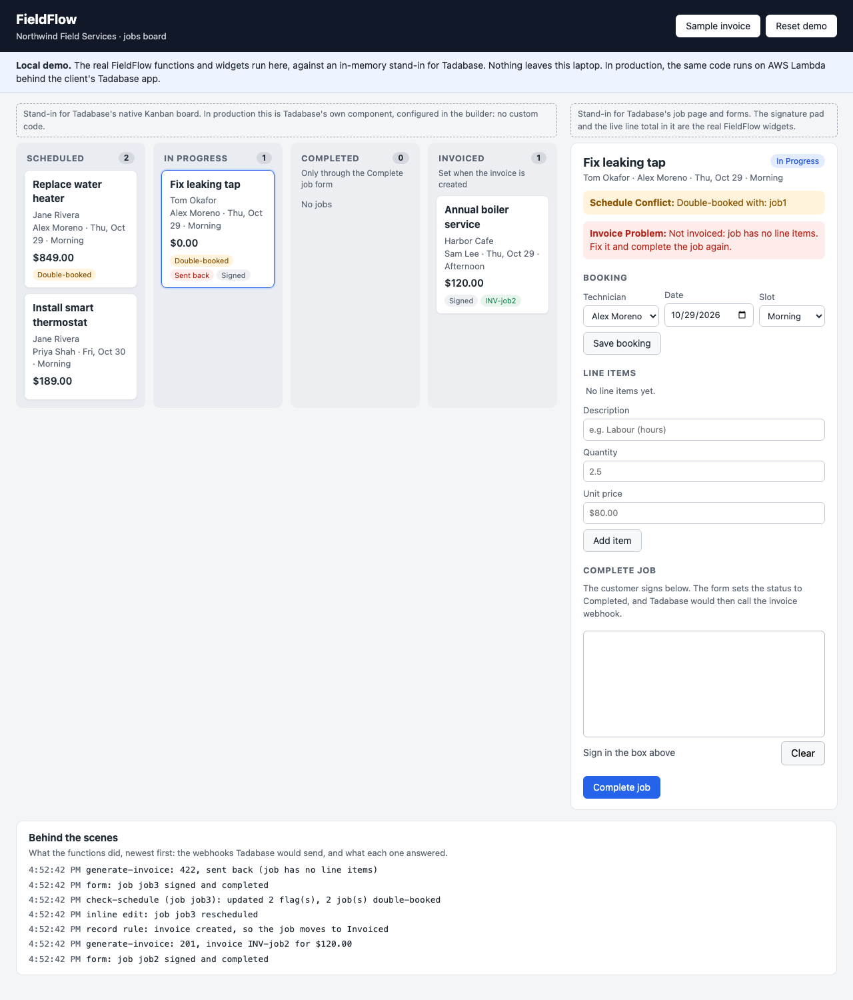
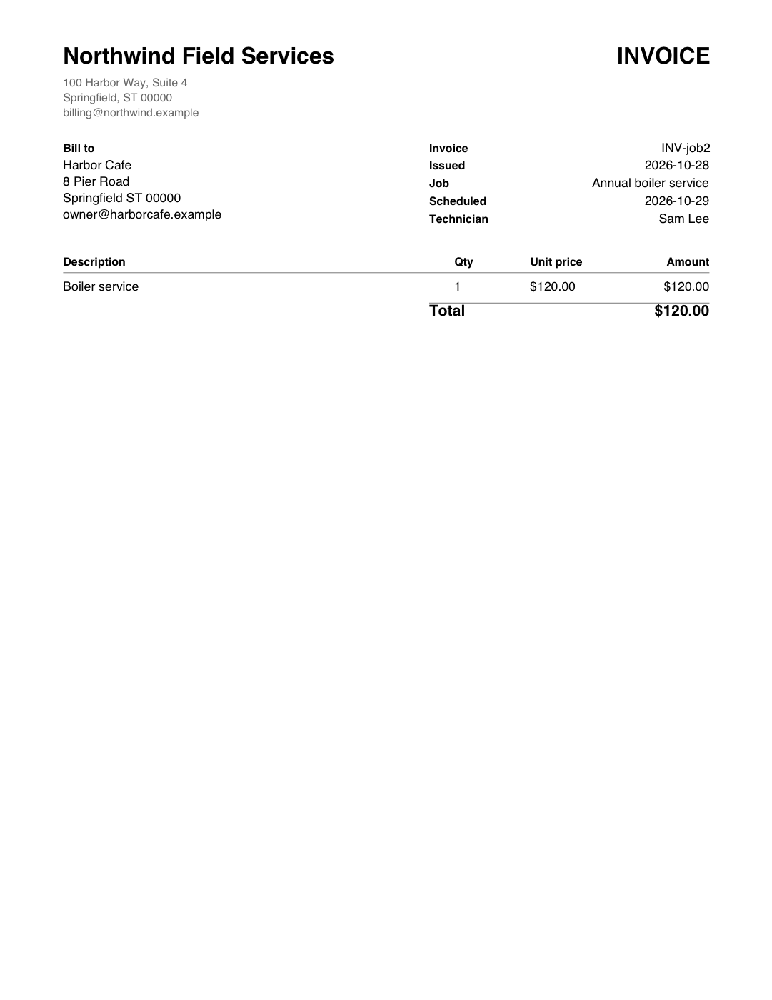
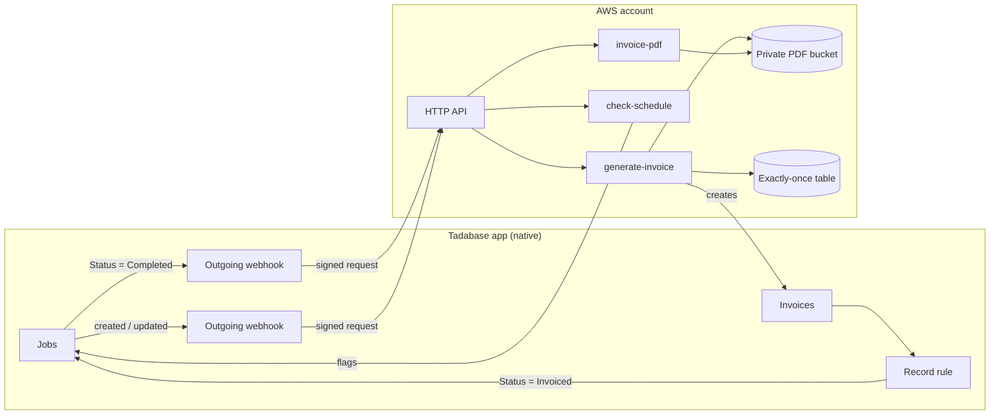

# FieldFlow overview

Jobs, technicians, customer signatures and invoices, run in a **Tadabase** app, with a small,
tested **AWS** layer only where Tadabase stops.

- **Native first:** code only where Tadabase can't do the job.
- **4 small AWS Lambda functions** and 2 page widgets.
- **900+ automated tests,** and CI that validates and builds the AWS template on every push.
- **About $0 a month on AWS** at a small business's volume.

Status: built and tested, and runs locally today ([try it in 1 minute](../README.md#try-it-in-1-minute-local-demo)).
It hasn't been deployed against a live Tadabase app yet; [go-live.md](go-live.md) is the
step-by-step guide for that.

## A job, start to finish

| Step | Built with | What happens |
|---|---|---|
| 1. **Scheduled** | Native | Booked on a technician, a date and a slot. The form refuses a double booking; one that gets past it (a drag, inline edit or import) is flagged within seconds by `check-schedule`. |
| 2. **In progress** | Native + widget | Moved on Tadabase's Kanban board. Line items show their total while the technician types, with the same money rules the invoice uses. |
| 3. **Completed** | Widget + code | The customer signs on screen. A job that isn't ready (no signature, line items or customer) is sent back to In Progress with the reason, however it was completed. |
| 4. **Invoiced** | Code | `generate-invoice` renders the PDF, stores it privately and adds the invoice record with a signed link, exactly once, even if the webhook is delivered twice. |

## See it work

This is the local demo: the real FieldFlow functions and widgets, running on a laptop against an
in-memory stand-in for Tadabase. It's the same code that deploys to AWS Lambda; only the Tadabase
connection is simulated. Anyone with the repository can run it with `npm install && npm run demo`.

*The board and the job page are the demo's stand-ins for Tadabase's own screens: in production the
board is Tadabase's native Kanban, with no custom code. The signature pad, the line total and
everything in the log are real FieldFlow code. Shown: a double booking flagged, a job sent back for
missing line items, and an invoiced job, with each webhook and what the function answered.*

*The invoice PDF that `generate-invoice` rendered, opened through its signed, private link.*

## Native vs custom

Every piece of code exists because Tadabase can't do that job natively. Everything else uses
Tadabase's own tables, forms, rules and components, which a team can change without a developer.

| Need | Built with | Why |
|---|---|---|
| Customers, technicians, jobs, items, invoices | **Native** | Tadabase tables, forms and pages |
| Line and job totals | **Native** | Formula and rollup fields |
| Kanban board, drag to change status | **Native** | Tadabase's Kanban component, with Completed and Invoiced locked |
| Form checks, double booking on the form | **Native** | Form validation rules |
| PDF invoice, stored privately, signed link | **Code** | Tadabase can't render PDFs or store private files |
| Signature capture, live line total | **Code** (widgets) | Native forms have no drawing pad, and totals update only on save |
| Double booking caught after a drag, inline edit or import | **Code** | Validation rules only run on forms |
| Unready jobs sent back with the reason | **Code** | Rules can't count a job's items or see a board drag |

The plan originally had a custom drag-and-drop board. Tadabase's docs describe a native Kanban
component with drag-to-update, so the board is configured instead of built
([plan 06](plans/06-native-kanban-board.md)). That's still to be confirmed in a live app; if drag
isn't available, native action buttons on each card change the status instead, still with no
custom code. A CRM sync was left out because it wasn't needed
yet; its design is kept in [plan 07](plans/07-job-checks.md#follow-ups).

## How the pieces connect

## Built to be safe with real data

- **One invoice per job, always.** Retried or duplicate webhooks never create a second invoice: a
  claim table and a check for an existing invoice both guard it.
- **Money in whole cents.** Prices are parsed strictly. An amount like `1.234,50` is refused, never
  guessed, and a total that doesn't match its items stops the invoice.
- **Private invoices.** PDFs live in a private bucket. Each link carries a signature, and only that
  exact link opens that one PDF.
- **Least privilege.** Each function has its own permissions, limited to exactly what it uses.
  Secrets live in AWS Parameter Store, never in code.
- **Data survives deploys.** Storage is retained on delete and on replacement, and the tests fail
  the build if that ever changes.
- **Reviewed before it ships.** Every deploy is a changeset that's reviewed before anyone runs it.

## How it was built with Claude Code

The project includes its whole Claude Code setup (`.claude/` and [CLAUDE.md](../CLAUDE.md)), so the
way it was built can be checked, not just described.

- **A plan before any code.** Every feature started as a short written plan, approved before
  building: [docs/plans](plans/README.md) has all 9, each with its decisions, review findings and
  commits.
- **Project rules** in CLAUDE.md: build natively first; tests never touch the live Tadabase app;
  no hard-coded Tadabase field ids in handlers; every webhook handler is safe to run twice.
- **Safety hooks** that run on every command: Claude can only run read-only AWS commands, can't
  read or print secrets, and can't deploy. A deploy is a preview that a person reviews and runs.
- **Reviewer agents** (code, security and AWS infrastructure) check every change before it's
  committed. They caught real issues, for example:
  - a Tadabase error that could have wrongly undone a completed job ([plan 07](plans/07-job-checks.md#review-review-diff-2026-10-28))
  - a gap in the safety hooks themselves ([plan 08](plans/08-go-live.md#review-review-diff-2026-10-28))
  - demo totals that were more forgiving than production ([plan 09](plans/09-local-client-demo.md#review-review-diff-2026-10-28))
- **Checks before every commit:** a secret scan, lint and the full test suite, plus CI on GitHub.

## Going live

| Item | Cost | Notes |
|---|---|---|
| Tadabase | Existing plan | Needs a plan with outgoing webhooks (Pro or higher) |
| AWS Lambda, API Gateway, DynamoDB | ≈ $0 / month | Pay per request; a small business's volume sits within or near the free tier |
| S3 (invoice PDFs, a few KB each) | Cents a year | Kept indefinitely, as financial records should be |
| Logs, secrets, sign-in | $0 | Logs kept 30 days; standard SSM parameters and IAM Identity Center are free |

The [go-live guide](go-live.md) covers the AWS account, the Tadabase setup, the first deploy and
every live check, and works on a duplicate of the Tadabase app first, so live data is never touched
while it's being proven. Names in the demo (Northwind Field Services, its customers and
technicians) are fictional.
